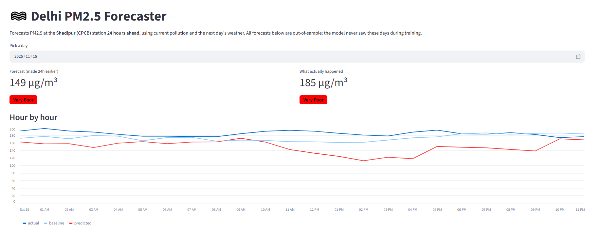

# 🌫️ Delhi PM2.5 Forecaster

Forecasts PM2.5 air pollution at the **Shadipur (CPCB) station in Delhi, 24 hours ahead**, from current pollution readings and the next day's weather.

**🔗 Live demo:** https://delhi-aqi-forecaster.streamlit.app



---

## Problem

Delhi has some of the worst air quality in the world, especially from October to January. A day-ahead PM2.5 forecast helps people plan: whether to exercise outdoors, wear a mask, or keep children indoors.

**Goal:** given the pollution and weather at any hour, predict PM2.5 exactly 24 hours later, and show it as an Indian National AQI category (Good → Severe).

---

## Data

| Source | What | Period | Granularity |
|---|---|---|---|
| [CPCB via OpenCity](https://data.opencity.in/dataset/delhi-hourly-air-quality-reports) | PM2.5, PM10, NO, NO₂, NOx, NH₃, SO₂, CO, O₃, benzene, toluene at Shadipur | Jan 2024 – Dec 2025 | 15 minutes |
| [Open-Meteo Historical Weather API](https://open-meteo.com/en/docs/historical-weather-api) | Temperature, humidity, dew point, rain, wind, pressure, cloud cover, boundary layer height | Jan 2024 – Dec 2025 | Hourly |

Weather data by [Open-Meteo.com](https://open-meteo.com/) (CC BY 4.0).

---

## What made the data messy (and how I handled it)

- **Mislabeled time zone.** Pollution timestamps were labeled UTC (`+0000`), but solar radiation peaked at 12:00, which is noon in Indian time. The timestamps were already IST, so I removed the wrong label instead of converting. Converting would have shifted every reading 5.5 hours against the weather data.
- **Different intervals.** Pollution was every 15 minutes, weather hourly. I averaged pollution to hourly.
- **Empty and incomplete columns.** Xylene, O-Xylene and the station's own temperature, rainfall and pressure columns were empty or nearly empty, so I dropped them and used Open-Meteo for weather.
- **Sensor outages.** Gaps of up to 3 hours were filled by time interpolation; longer gaps were dropped rather than invented (2.8% of hours).
- **Missing boundary layer height.** Open-Meteo has no BLH for Delhi before July 2024, even from ERA5. I excluded it from the main model.
- **Outliers.** One spike of ~966 µg/m³ in October 2025 lasting about an hour, likely a sensor glitch. I used an absolute-error loss so single spikes don't distort training.

---

## Approach

```
Raw CSVs → clean & align time → hourly merge → features → walk-forward training → evaluation → Streamlit app
```

**Features (48):**
- Current pollutants
- PM2.5 lags (1, 2, 3, 6, 12, 24, 48 hours), rolling 6h/24h means, 24h standard deviation and 24h change
- Time: hour and month as sin/cos, day of week, winter flag
- Wind as east-west / north-south components
- **Next-day weather** (temperature, humidity, dew point, wind, pressure, cloud cover, total rain over the next 24 hours)

**Model:** scikit-learn `HistGradientBoostingRegressor` with absolute-error loss, **retrained monthly** (walk-forward).

**Train/test split:** by time, never randomly. Training data runs up to June 2025; the test period is July–December 2025, including the October–December smog season.

---

## Evaluation

All models were scored on exactly the same test hours (Jul–Dec 2025).

| Model                        |   MAE |   RMSE |    R² |
|:-----------------------------|------:|-------:|------:|
| Baseline: same as now        |  23.4 |   49.7 | 0.451 |
| Baseline: last 24h average   |  23.9 |   46.2 | 0.525 |
| GB + weather (trained once)  |  26.2 |   45.6 | 0.538 |
| **GB walk-forward**          |  24.3 | **44.1** | **0.568** |
| GB walk-forward (log target) |  24.2 |   44.7 | 0.556 |

**AQI category accuracy:** baseline 59.0%, model 58.1%.

MAE and RMSE are in µg/m³; lower is better. R²: higher is better.

### What I learned

1. **The first model lost to the baseline.** Gradient boosting trained once scored worse than "PM2.5 tomorrow = PM2.5 now". Checking against a baseline caught this.
2. **Distribution shift was the cause.** Late 2025 at this station was much cleaner and flatter than 2024 (November averaged 268 µg/m³ in 2024 vs 138 in 2025, with a standard deviation of 118 vs 35). The model learned 2024 patterns and overpredicted by +12 to +17 µg/m³.
3. **Two changes fixed most of it:** adding next-day weather, and retraining monthly so the model adapts to recent behavior.
4. **Honest result:** the final model beats both baselines on RMSE and R², meaning fewer large misses when pollution changes sharply. On calm days it roughly matches persistence (MAE and category accuracy within about 1 point).

---

## Limitations

- **Next-day weather in testing is actual reanalysis weather.** In live use it would come from a forecast, which is less accurate, so test scores are slightly optimistic.
- **One station only.** Results may not transfer to other parts of Delhi.
- **AQI categories** use official 24-hour breakpoints; hourly categories are an approximation.
- **Why 2025 was so much lower** than 2024 (genuinely cleaner air vs. instrument changes) is unresolved.

---

## Cost

₹0. All data is free and public, the model trains on a laptop in under a minute, and the app is hosted on Streamlit Community Cloud's free tier.

---

## Project structure

```
aqi-forecaster/
├── app.py                  # Streamlit web app
├── requirements.txt
├── data/
│   ├── raw/                # original downloads (never edited)
│   └── processed/          # cleaned, merged and feature files
├── models/
│   └── aqi_model.joblib    # final trained model + feature list
├── notebooks/
│   ├── 01_explore.ipynb    # load, inspect, clean, merge
│   ├── 02_features.ipynb   # feature engineering
│   └── 03_train.ipynb      # baselines, models, evaluation
└── reports/
    ├── evaluation_table.csv
    └── test_predictions.csv
```

---

## Run it locally

```bash
git clone https://github.com/Alyasar/aqi-forecaster.git
cd aqi-forecaster
python -m venv .venv
.venv\Scripts\activate        # Windows
pip install -r requirements.txt
streamlit run app.py
```

---

## Tech stack

Python · pandas · NumPy · scikit-learn · Matplotlib · Streamlit

---

## Next steps

- Live forecasts: pull current readings from the data.gov.in API and the Open-Meteo forecast API daily
- Add more Delhi stations
- Try LightGBM / XGBoost and hyperparameter tuning
- Investigate the 2024 → 2025 level shift
